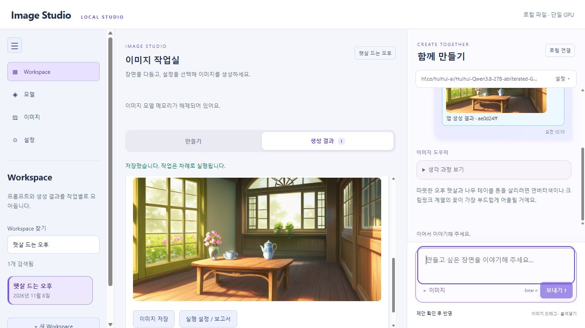
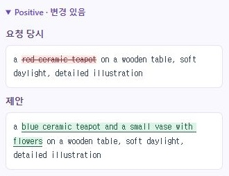
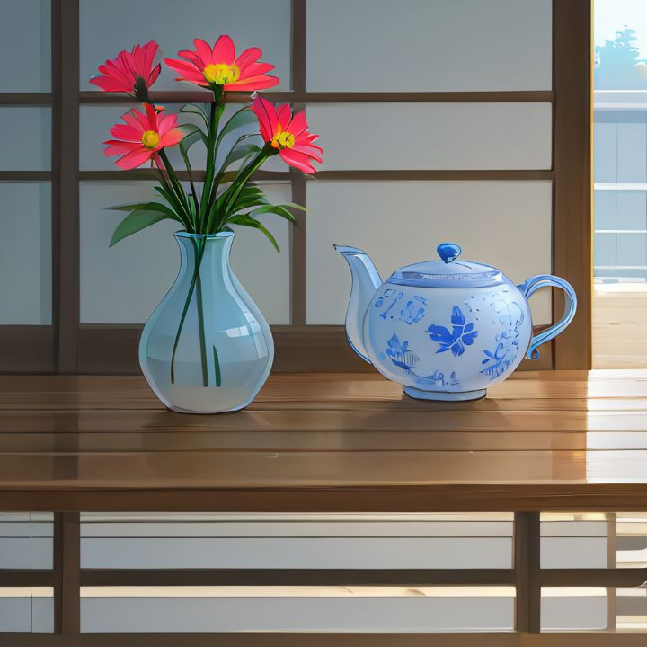

# Image Studio

로컬 LLM과 대화하며 프롬프트를 다듬고, 내 PC의 이미지 모델로 그림을 만드는 웹 작업실입니다. Ollama와 함께 장면을 구체화하거나 직접 프롬프트를 작성해, 생성부터 보정·확대까지 한곳에서 이어갈 수 있습니다.



왼쪽에서 Workspace와 모델을 관리하고, 가운데에서 프롬프트와 생성 결과를 다룹니다. 오른쪽 채팅에는 참고 이미지를 첨부하거나 이전 생성 결과를 가져와 다음 그림을 의논할 수 있습니다.

## 주요 기능

- **프롬프트 공동 편집** — positive/negative 프롬프트, 변경 비교, 수동·자동 반영, 반영 후 생성
- **이미지를 보며 대화** — 참고 이미지와 생성 결과의 출처 구분, 스트리밍 답변, 모델별 reasoning과 고급 옵션
- **모델 관리** — 폴더 검색, Checkpoint·LoRA·VAE 등 유형별 목록, 구성요소 호환 확인
- **생성과 후처리** — 텍스트 생성, 참고 이미지 변형, 마스크 편집, 확대와 디테일러, 원본·보정 결과 비교
- **Workspace별 기록** — 대화, 프롬프트, 생성 설정과 결과를 로컬 파일로 보관

SD 1.5/2.1, SDXL·WAI, ANIMA, Krea2, FLUX.2 Klein, Z-Image로 이미지를 생성할 수 있습니다. 생성·편집 방식과 LoRA·인코더·VAE 조합은 모델마다 다릅니다. 모델 메뉴에서 준비 상태와 호환 안내를 확인하세요.

## 대화로 다듬고, 비교하며 반영하기

프롬프트 수정 제안에서는 요청 당시 원문과 바뀐 부분을 비교할 수 있습니다. 아래 화면은 빨간 찻주전자를 파란색으로 바꾸고 꽃병을 추가한 예시입니다. Positive와 Negative를 각각 확인한 뒤 반영하거나, 익숙해지면 자동 반영과 생성까지 연결하세요.



“찻주전자를 파란색으로 바꾸고 작은 꽃병을 옆에 추가해 줘.” 대화로 다듬은 프롬프트로 만든 이미지입니다.



## 내 모델로 작업하기

모델 보관함에서 Checkpoint·LoRA·VAE·인코더 등을 유형과 이름으로 찾고, 현재 체크포인트와의 호환 안내를 확인합니다. 작업실의 **만들기** 탭에서 이미지 모델과 생성 방식을 고르고, **생성 결과** 탭에서 원본과 최종 결과를 살펴보세요.

이미지 모델과 LoRA 등은 별도로 준비해야 합니다.

## 실행 환경

- Windows, NVIDIA GPU와 CUDA 12.8 호환 드라이버
- Python 3.12, [uv](https://docs.astral.sh/uv/)
- LLM 대화용 [Ollama](https://ollama.com/)
- 사용할 이미지 모델과 구성요소를 저장할 공간

검증 환경은 **RTX 5060 Ti 16GB, RAM 64GB**입니다. 이는 최소 요구 사양이 아닌 참고 환경이며, 필요한 메모리와 생성 시간은 모델·해상도·후처리에 따라 달라집니다. 앱은 가용 메모리에 맞춰 GPU 배치와 오프로딩을 조정합니다.

## 설치와 실행

먼저 [uv](https://docs.astral.sh/uv/)를 설치하고 프로젝트를 받습니다. Git을 사용한다면 터미널에서 다음 명령을 실행하세요.

```powershell
git clone https://github.com/eusa-sam/image-studio.git
cd image-studio
```

ZIP으로 받았다면 압축을 풀고 해당 폴더에서 실행합니다. 처음 시작할 때 Python 환경과 의존성을 설치합니다.

```powershell
.\start.bat
```

브라우저에서 **http://127.0.0.1:8765**를 엽니다.

```powershell
# 실행 상태
uv run --no-sync python -m scripts.server status

# 서버 종료
.\stop.bat
```

실행 로그는 `data/runtime/server/<실행 ID>/server.log`에 저장됩니다. 터미널에서 로그를 직접 보려면 `uv run --no-sync python -m backend.app.main`으로 실행하고 `Ctrl+C`로 종료할 수 있습니다.

## 첫 이미지 만들기

1. 이미지 모델을 `models/`에 넣습니다. SDXL 체크포인트로 시작한다면 아래 명령으로 tokenizer와 설정 파일도 준비합니다.

   ```powershell
   uv run --no-sync python -m scripts.prepare_sdxl
   ```

   이 명령은 Hugging Face에서 SDXL 구성 파일을 내려받습니다. 체크포인트 가중치는 별도로 준비하세요. 다른 계열은 `scripts/prepare_*.py`의 해당 준비 스크립트를 사용하며, 모델별 다운로드 용량과 사용 조건을 먼저 확인하세요.

2. **모델 → 폴더 다시 검색**에서 모델의 준비 상태를 확인합니다. 폴더 형태의 모델은 원래 구성과 하위 경로를 유지합니다.
3. Workspace를 만들고 체크포인트, 크기, 생성 옵션을 선택합니다.
4. 프롬프트를 작성한 뒤 **이미지 생성**을 누릅니다. 프롬프트만 보관하려면 **프롬프트 저장**을 선택합니다.
5. **생성 결과**에서 이미지를 열거나, **원본으로 변형** 또는 **최종 결과로 변형**을 선택해 다음 작업에 사용합니다.

확대와 디테일러에는 각각 사용할 모델이 필요합니다. 얼굴·손 보정의 품질은 원본과 설정에 따라 달라지므로 보정 전후 이미지를 비교해 선택하세요.

## Ollama와 대화하기

Ollama를 실행하고 사용할 모델을 준비하면 오른쪽 **함께 만들기**에서 연결 상태를 확인할 수 있습니다. 상단 **설정**을 펼쳐 대화 모델을 선택하세요. 이미지 참고에는 이미지 입력을 지원하는 모델이 필요합니다.

대화에서 원하는 구도나 화풍을 설명하고 제안된 프롬프트를 적용합니다. 입력창 아래에서 **제안 확인 후 반영**, **작업실에 자동 반영**, **자동 반영하고 생성**으로 작업 방식을 선택할 수 있습니다. 응답을 기다리는 동안 프롬프트를 직접 수정했다면 변경 내용을 비교한 뒤 반영하세요.

채팅의 모델 고급 설정에서 출력·문맥 토큰 수, temperature, top_p 등의 요청 옵션을 지정할 수 있습니다. reasoning 선택지는 모델이 지원하는 방식에 맞춰 표시됩니다.

## 설정과 저장 위치

왼쪽 **설정**에서 경로와 Ollama 연결을 변경할 수 있습니다.

| 항목 | 기본값 |
|---|---|
| 모델 폴더 | `models/` |
| 이미지 출력 폴더 | `outputs/` |
| Ollama URL | `http://127.0.0.1:11434` |
| Ollama API 경로 | `/api` |
| 앱 설정 파일 | `data/settings/application.json` |

Workspace와 작업 원본은 `data/`에 보관하고, 결과 이미지·프롬프트·설정은 출력 폴더에도 저장합니다. 백업할 때는 `data/`, 모델 폴더와 별도로 지정한 출력 폴더를 함께 챙기세요. 의존성과 앱의 다운로드 캐시는 프로젝트의 `data/cache/`를 사용합니다.

## 업데이트

Git으로 받은 프로젝트에서 로컬 소스 변경을 정리한 뒤 실행합니다. 현재 브랜치에 upstream이 설정되어 있어야 합니다.

```powershell
.\update.bat
```

새 버전을 확인한 뒤 실행 중인 서버를 정상 종료하고, fast-forward로 소스를 갱신해 의존성을 설치합니다. 이전에 실행 중이던 서버는 다시 시작합니다. 설치나 재시작에 실패하면 이전 커밋과 환경으로 복구를 시도하고 결과를 `data/runtime/server/update-*.json`에 남깁니다.

모델·Workspace·출력·개인 설정은 업데이트 과정에서 보존됩니다. 업데이트 전 `data/`, 모델·출력 폴더를 백업해 두세요. 소스를 직접 수정했거나 ZIP으로 설치했다면 서버를 종료하고 새 버전의 소스를 교체한 뒤 `uv sync --locked`를 실행합니다.

## Docker Compose

NVIDIA GPU를 사용할 수 있는 Docker Engine과 Compose가 필요합니다. Windows에서는 Docker Desktop의 WSL 2 GPU 지원을 준비하고, 디스크 이미지 저장 위치를 여유 공간이 충분한 드라이브로 지정하세요. **컨테이너 GPU 실행은 아직 검증하지 않았습니다.**

먼저 Windows 서버를 종료합니다. 같은 데이터 폴더를 사용하는 서버는 하나만 실행하세요.

```powershell
.\stop.bat
# 경로를 바꾸려면 .env.example을 .env로 복사해 수정
Copy-Item .env.example .env

docker compose config
docker compose up -d --build
docker compose logs -f studio
```

접속 주소는 **http://127.0.0.1:8765**입니다. 기본적으로 프로젝트의 `models/`, `data/`, `outputs/`를 연결하며 `.env`에서 다른 전체 경로를 지정할 수 있습니다. 모델 폴더는 읽기 전용입니다. 준비 스크립트와 모델 다운로드는 호스트에서 실행한 뒤 컨테이너를 시작하세요.

컨테이너 설정은 `data/settings/container.json`, Windows 설정은 `data/settings/application.json`에 따로 저장합니다. Workspace와 대화·생성 기록은 공유하고, 컨테이너 안의 모델·출력 경로는 `/app/models`, `/app/outputs`를 사용합니다. 기존 Windows 경로 설정은 그대로 보존됩니다.

Ollama의 기본 연결은 `http://host.docker.internal:11434`입니다. 호스트 Ollama가 Docker에서 접근 가능한 인터페이스에 수신하도록 설정하고, 방화벽은 Docker의 로컬 연결만 허용하세요. 연결 여부는 앱 설정의 연결 테스트로 확인할 수 있습니다.

```powershell
# 정상 종료: 연결한 모델·데이터·출력 폴더는 유지
docker compose down

# 새 소스를 받은 뒤 이미지 갱신
docker compose build
docker compose up -d
```

서버 로그는 `docker compose logs studio`, GPU 인식은 `docker compose exec studio nvidia-smi`로 확인합니다. 설치 문제를 확인할 때는 네이티브 서버를 종료한 뒤 `uv sync --locked`와 `uv pip check`를 실행하세요.

## 개발

```powershell
uv run --no-sync python -m unittest discover -s tests -v
uv pip check
node --experimental-vm-modules --test tests/*.test.mjs
```

마지막 명령은 Node.js가 필요합니다. 모델·가중치의 이용 조건은 각 배포처의 라이선스를 따릅니다.
